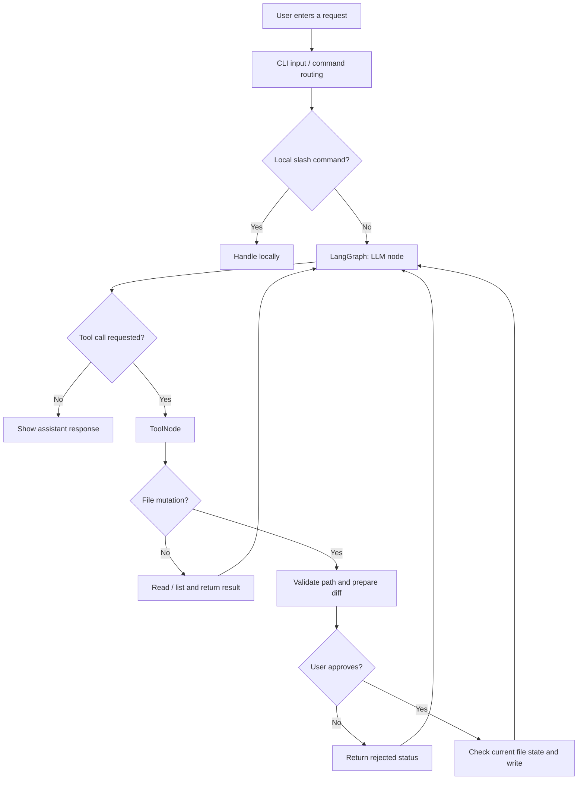

<div align="center">

# CLIFF.

### THE EDGE IS YOURS.

**Your codebase. Your terminal. An AI assistant that works where you work.**

A terminal-first AI coding assistant built with **Node.js, Groq, LangChain, and LangGraph**.

[](https://nodejs.org/)
[](https://developer.mozilla.org/en-US/docs/Web/JavaScript)
[](https://github.com/langchain-ai/langgraphjs)
[](https://groq.com/)

**[Explore Features](#-what-cliff-can-do)** · **[Get Started](#-getting-started)** · **[How It Works](#-under-the-hood)** · **[The Build Story](#-what-it-took-to-build)**

<sub>CLIFF v1 · Create. Read. Update. Learn.</sub>

</div>

---

## ✨ What CLIFF can do

| | Capability | What it means |
|:--:|---|---|
| 💬 | **Terminal-first conversations** | Ask questions and work with an AI assistant without leaving the command line. |
| 📖 | **Read project files** | Let CLIFF inspect files and use their contents to answer questions. |
| 🗂️ | **Explore directories** | List files and folders to discover what's in a workspace. |
| ✍️ | **Create files** | Generate new files from natural-language instructions. |
| 🛠️ | **Edit existing files** | Apply targeted text changes instead of blindly replacing entire files. |
| 🔍 | **Review changes** | See a diff of proposed changes before a write. |
| ✅ | **Approve or reject writes** | Keep a human decision in the file-mutation loop. |
| 🧠 | **Session conversation memory** | LangGraph checkpointing preserves context within the running process. |
| ⚙️ | **Local configuration** | Manage the Groq API key and selected model through CLIFF's configuration flow. |

**V1 scope:** creating, reading, listing, and updating files. CLIFF is **not** presented as a fully autonomous coding agent, and deletion or shell execution are not part of this v1 feature set.

### A quick look at the workflow


<sub>Illustrative terminal session; exact visual output depends on the current CLI UI.</sub>


## 🚀 Getting Started

### Prerequisites

- **Node.js** (v20 or later recommended)
- A free [Groq API Key](https://console.groq.com/keys)
- A terminal and a project to work on

### 1. Install CLIFF

Install globally using npm:

```bash
npm install -g cliff-ai
```

Or run directly without installing:

```bash
npx cliff-ai
```

### 2. Launch CLIFF

Navigate to your project directory and start CLIFF:

```bash
cd path/to/your/project
cliff
```

On your first launch, CLIFF will guide you through configuring your **Groq API key** and selecting an AI model.

> [!IMPORTANT]
> Always launch CLIFF **inside your project directory**. CLIFF treats the current working directory as its workspace. Review file modifications before approving them.

### 3. Start Building ✨

Try asking CLIFF:

```text
> Read README.md and explain this project.

> Create a utils.js file with an email validation function.

> Update the multiply function in calculator.js to handle invalid inputs.

> List all files and identify the project's entry point.
```

### 🔗 Useful Links

[](https://www.npmjs.com/package/cliff-ai)

> **CLIFF v1** focuses on reading, creating, and updating project files with AI-powered assistance and user-controlled approvals.

## 🧰 Tech stack

| Layer | Technology | Why I used it |
|---|---|---|
| Runtime | **Node.js + JavaScript (ES Modules)** | To build a real terminal application and work directly with the filesystem. |
| LLM inference | **Groq API + ChatGroq** | To power model responses and tool calling. |
| AI integration | **LangChain** | To connect models, messages, and callable tools. |
| Agent workflow | **LangGraph** | To organize the model → tools → model execution loop. |
| Conversation state | **MessagesAnnotation + MemorySaver** | To manage message state and retain conversation context during a session. |
| Input validation | **Zod** | To define structured schemas for tool arguments. |
| Filesystem | **Node.js `fs/promises` + `path`** | To read, list, create, and update workspace files. |
| Terminal UX | **Chalk and terminal UI utilities** | To build a readable, branded CLI experience. |
| Change previews | **Text diff / patch generation** | To show exactly what an edit proposes to change. |

## 🧩 Under the hood

CLIFF is more than a chatbot wrapped in a terminal. Its core is a **tool-using agent loop**.



### A few technical decisions that mattered

**1. Keep the model separate from the filesystem.** The LLM proposes *what* to do; JavaScript tools perform the actual file operations. This lets the application validate inputs, limit workspace access, and request approval.

**2. Use structured tool arguments.** Zod schemas define the expected paths, contents, and edit instructions. A schema makes the contract clearer, though it cannot guarantee the LLM will always produce valid JSON.

**3. Prefer targeted edits.** Rather than rewriting an entire file for a small change, CLIFF can replace a chosen occurrence of text. The edit is prepared and previewed before writing.

**4. Serialize file mutations.** A process-wide Promise queue is designed to keep approval prompts and file writes from overlapping. The critical section includes reading, preparing, reviewing, checking, and writing—not just the approval question.

**5. Treat conversation memory realistically.** LangGraph's `MemorySaver` helps preserve conversation history during the running session. It is **not persistent memory across restarts**.

> [!CAUTION]
> Approval prompts and a mutation queue reduce accidental writes, but they do not make filesystem operations perfectly race-proof. Other processes can still modify files, and path/symlink validation requires careful implementation and testing.

## 🛠️ What it took to build

This was my **first project bringing Node.js and AI integration together**. I knew the idea: give an LLM tools and let it help with code. The actual engineering was where the learning happened.

### The problems that taught me the most

| Challenge | What I learned |
|---|---|
| **From a chatbot to an agent** | A model response is not the same as an action. Tool calls need routing, execution, and results returned to the model. |
| **LangGraph message state** | Why message reducers matter, why tool-call metadata must be preserved, and how a `ToolNode` fits into the loop. |
| **Managing configuration** | How to use a small stateful class for settings without turning every utility into a class. |
| **Editing the right text** | How to reason about repeated occurrences, indexes, missing matches, and exact string replacement. |
| **Displaying safe diffs** | Why deterministic JavaScript-generated patches are more trustworthy than asking an LLM to describe its own edits. |
| **Overlapping approval requests** | Why locking only the input prompt isn't enough—and why the whole file-mutation lifecycle needs coordination. |
| **Workspace boundaries** | How path traversal, symlinks, and stale contents can make seemingly simple file tools risky. |
| **Malformed tool-call JSON** | Some Groq responses failed while generating file content—particularly HTML/CSS—before the filesystem tool ever ran. I learned to separate model/API failures from application bugs. |
| **API and model behavior** | That an available model isn't necessarily suitable for every tool-calling workflow, and that retries and token limits need care. |

I spent a surprising amount of time learning things that don't show up in screenshots: asynchronous execution, promises, filesystem edge cases, state, and how to avoid losing user data.

And that turned out to be the most valuable part.

### How I used AI while building CLIFF

I used AI as a **development partner**, particularly for brainstorming and refining the terminal UI/UX. Codex helped explore a more cohesive visual direction for the welcome screen, tool activity, diffs, approvals, errors, and configuration flows.

The goal was to keep the UI **separate from CLIFF's core logic**, so visual improvements wouldn't silently change the agent's behavior.

For the underlying engineering, I used AI to review ideas, understand unfamiliar concepts, and spot edge cases—but kept the focus on understanding *why* each decision was needed instead of blindly accepting generated code.

**AI helped me iterate faster. Building CLIFF helped me think more independently.**

## 📚 What I learned

- Writing a practical Node.js CLI using ES Modules and asynchronous APIs.
- Organizing code around responsibilities: providers, tools, services, utilities, and presentation.
- Building agent workflows with LangChain, LangGraph, message state, and tool routing.
- Designing Zod schemas and handling structured LLM tool calls.
- Working with filesystem paths, reads, writes, errors, and user approvals.
- Using Promises to control concurrency rather than hoping operations execute in order.
- Comparing proposed changes with the actual file state before writing.
- Thinking about UX in a terminal—not just functionality, but trust, clarity, and feedback.
- Distinguishing a model failure, API limitation, UI issue, and application logic bug.

## 🗺️ What's next?

CLIFF v1 intentionally stops at **Create · Read · Update**. There's plenty of room to grow without rushing into features before the foundations are reliable.

- [ ] **Stronger filesystem safeguards:** more rigorous symlink checks, conflict detection, and regression tests.
- [ ] **More reliable code generation:** improve large HTML/CSS/JS tool calls and targeted retry handling.
- [ ] **Persistent memory:** keep useful context across CLI sessions, with controls for resetting it.
- [ ] **Smarter context management:** reduce token usage by selecting only relevant files and conversation history.
- [ ] **Granular permissions:** configurable approval policies for individual tools and paths.
- [ ] **Better edit previews:** clearer diff navigation and easier review of multiple file changes.
- [ ] **Expanded developer tools:** potentially safe command execution and additional agent capabilities in later versions.
- [ ] **Automated testing:** cover rejected writes, stale edits, duplicate matches, path traversal, and concurrent requests.

These are **future directions, not current v1 features**.

## ⚠️ Current limitations

- LLM-generated tool arguments can occasionally be malformed, especially for complex file contents.
- Groq model availability, tool support, and rate limits can affect reliability.
- Memory held by `MemorySaver` is session-scoped unless a persistent checkpointer is added.
- Filesystem concurrency protections within one process do not prevent edits from another terminal or editor.
- CLIFF is an early learning project. Back up important files and inspect diffs before approving changes.

## 🤝 Feedback and contributions

I'm sharing CLIFF as a learning project and a foundation to keep improving. If you spot a bug, see an edge case I missed, or have an idea for a better terminal workflow, I'd love to hear it.

---


## 👨‍💻 Behind CLIFF

<table>
  <tr>
    <td width="70%" valign="top">
      <h3>Hey, I'm Raj Shah! 👋</h3>
      <p>
        I'm a Computer Science undergraduate at <b>Nirma University</b>,
        a full-stack developer, and the Founder of <b>Neurolearn Media</b>.
      </p>
      <p>
        I love building things that challenge what I already know.
        CLIFF started as my first serious Node.js + AI integration project,
        and turned into a journey of understanding how real AI coding
        assistants work under the hood.
      </p>
      <p>
        I'm currently exploring <b>AI agents, MERN development,
        and developer tooling</b> — learning by building, breaking,
        debugging, and improving.
      </p>
      <p><i>Still learning. Still shipping. 🚀</i></p>
    </td>
  </tr>
</table>

### 🌐 Let's Connect

<p align="left">
  <a href="https://rajshah.pro">
    
  </a>
  <a href="https://www.linkedin.com/in/rajshah-dev/">
    
  </a>
  <a href="https://github.com/rajshahdev966">
    
  </a>
</p>

> 💡 **Building CLIFF taught me one thing:** You don't need to understand everything before starting. Sometimes, building something is exactly how you learn to understand it.

<p align="center">
  Built with curiosity, countless debugging sessions, and a lot of learning.
  <br/>
  <b>Made by Raj Shah 🇮🇳</b>
</p>
